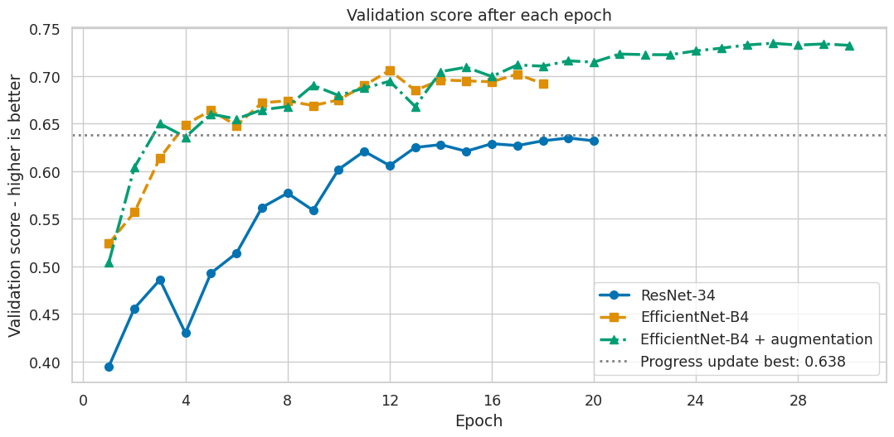
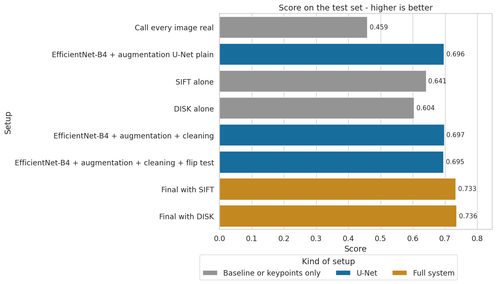
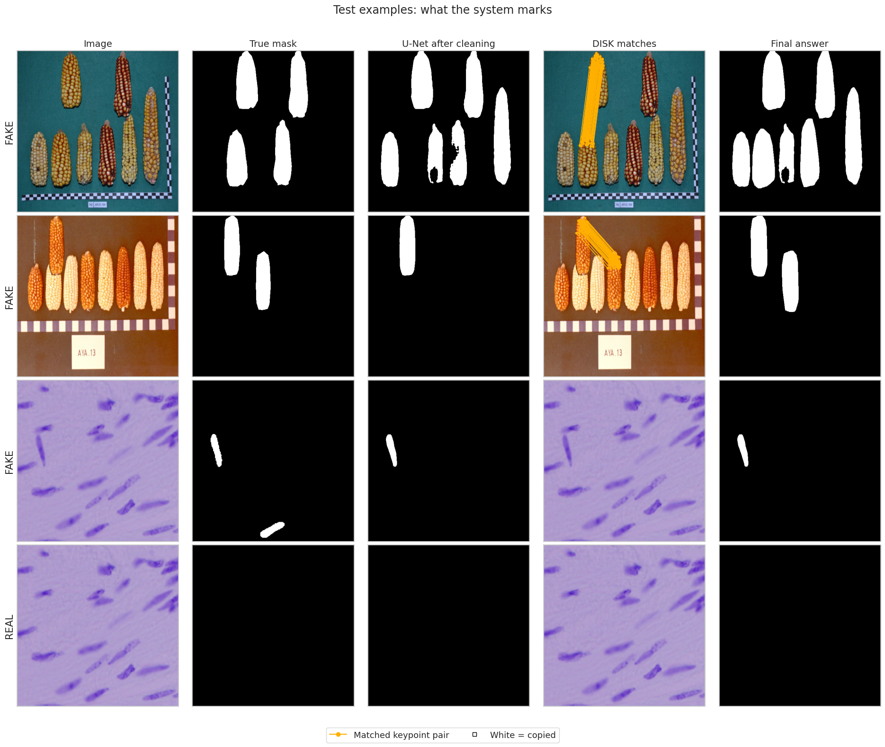

# Scientific Image Forgery Detection

**Author:** Zied Raboudi

**Course:** COSC 4358 Computer Vision, Fall 2026

## Overview
Some research papers contain faked images. One common trick is a copy-move forgery:
someone copies part of an image, like a cell or a band on a western blot, and pastes it
somewhere else in the same image.

In this project I built a system that takes a research image and returns a mask of the copied
parts. White means copied and black means clean. An empty mask means the image is real.

## How it works
1. Every image is resized to 512 by 512 pixels for the U-Net.
2. A U-Net with an EfficientNet-B4 encoder gives every pixel a score for how likely it is to
   be copied, plus one score for whether the whole image is fake.
3. A pixel turns white in the mask when its score is above the pass mark. The fake check drops
   the mask when the fake score of the whole image is too low.
4. Keypoint matching with SIFT or DISK finds spots that appear twice in the same image and
   adds those areas to the mask.
5. The mask settings and the keypoint method are chosen on validation images, and the final
   numbers come from a separate set of test images.

## Results
Measured on 519 test images that were never used for training or for choosing settings.

| Setup | Score | Fakes caught | False alarms | Mask F1 |
|---|---|---|---|---|
| Call every image real | 0.459 | 0% | 0% | 0.000 |
| U-Net plain | 0.696 | 75% | 5% | 0.478 |
| U-Net + cleaning + flip test | 0.695 | 74% | 5% | 0.476 |
| SIFT alone | 0.641 | 49% | 4% | 0.373 |
| DISK alone | 0.604 | 41% | 4% | 0.304 |
| Final with SIFT | 0.733 | 81% | 7% | 0.568 |
| **Final with DISK** | **0.736** | 80% | 6% | 0.565 |

How to read the table:
- **Score:** a real image scores 1 if nothing is marked and 0 otherwise. A fake image scores
  the overlap F1 between the predicted mask and the true mask, which is 1 for a perfect match
  and 0 for no overlap. The score is the average over all images.
- **Fakes caught:** the share of fake images where something is marked.
- **False alarms:** the share of real images that are marked by mistake.
- **Mask F1:** the average overlap F1 over the fake images only.
- **U-Net plain** is the model output with the pass mark and the fake check both at 0.5.
  **+ cleaning** uses the settings tuned on the validation images and erases tiny white specks
  from the mask. The **flip test** averages the scores over mirrored copies of each image.

What I found:
- The best validation score went from 0.635 with a ResNet-34 encoder to 0.706 with
  EfficientNet-B4, and to 0.734 with augmentation and longer training.
- Keypoint matching added the most after training. It raised the test score from 0.695 to 0.736.
- SIFT and DISK are too close to call inside the full system.

The ResNet-34 curve and the EfficientNet-B4 curve without augmentation are recorded from my
earlier runs. The final model is trained inside the notebook.

## Files
- `scientific_image_forgery_detection.ipynb` is the full project: the code, the plots and the
  written results.
- `plots/` holds the six plots from the notebook.

## How to run
The data comes from the Kaggle competition **Recod.ai/LUC Scientific Image Forgery Detection**
and is not included in this repository.

1. Upload the notebook to Kaggle.
2. Add the competition data with **+ Add Input**.
3. Set the accelerator to **GPU T4 x2** and turn the internet on.
4. Click **Save Version** and then **Save & Run All**. The full run takes about 2.5 hours.

## Tools
Python, PyTorch, segmentation-models-pytorch, Albumentations, OpenCV, Kornia, Matplotlib,
Seaborn and pandas.
